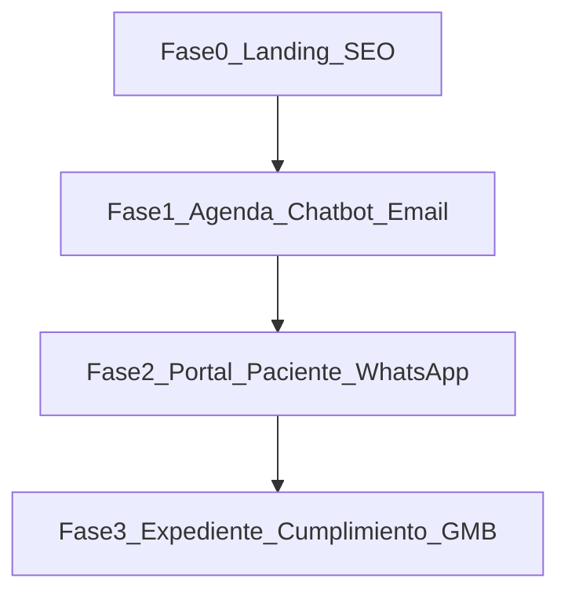

# Hoja de ruta — proyecto digital Dr. Geo Luque

El sitio web actual es **Fase 0**: presencia profesional, confianza y punto de partida para un ecosistema completo del consultorio.

## Visión

---

## Fase 0 — Carta de presentación (actual)

- [x] Landing responsive con servicios gine-obs
- [x] Enlaces a Instagram y flujo provisional de cita (WhatsApp / contacto)
- [x] SEO básico, Open Graph y datos estructurados (`Physician`)
- [x] Borrador de aviso de privacidad
- [ ] Contenido validado por el médico (foto, cédula, dirección, horarios)
- [ ] Despliegue en Vercel + dominio
- [ ] Perfil optimizado en [Google Business Profile](https://business.google.com/)

---

## Fase 1 — Agenda y automatización inicial

- Chatbot en la web para **agendar citas**, conectado a **una agenda única** (Google Calendar u otra fuente oficial del consultorio)
- Tipos de cita (primera vez, control prenatal, urgencia programada, etc.) y duraciones
- **Correos automáticos**: confirmación de cita, recordatorios (24–48 h), cancelación/reagendamiento
- Panel mínimo de recepción: vista del día, estados (confirmada, en sala, atendida)
- Lista de espera ante cancelaciones

**Tecnología prevista:** API en Next.js, Postgres, Resend (correo), integración calendario.

---

## Fase 2 — Paciente, WhatsApp y operación

- **WhatsApp Business API** (o capa intermedia) alineada con la misma agenda
- **Portal de paciente**: citas, documentos autorizados, formularios pre-consulta
- Encuestas breves post-consulta (satisfacción, sin datos clínicos en analytics)
- CRM ligero: origen del paciente, seguimiento de quien preguntó pero no agendó
- Pagos o señal de cita (si el consultorio lo adopta)

---

## Fase 3 — Expediente, cumplimiento y escala

- **Base de datos de pacientes** e historial clínico — decisión explícita: integrar EMR certificado vs módulo a medida
- Roles (médico, recepción, asistente), **auditoría de accesos**, backups y plan de incidentes
- Generación de PDFs (indicaciones, resúmenes autorizados)
- Teleconsulta (si aplica al modelo del consultorio)
- Extracción de paquetes compartidos si se replican sitios para otros especialistas de la familia

---

## Entregables para el “regalo” al médico

1. URL del sitio en producción (Fase 0)
2. Este `ROADMAP.md` como compromiso de evolución
3. Sesión breve de capacitación en cómo editar `site.ts` y próximos hitos
4. (Opcional) one-pager en PDF para consultorio

---

## Dependencias del Dr. Geo Luque

- Autorización de imagen, textos y datos de contacto
- Acceso o credenciales de agenda (solo cuando inicie Fase 1)
- Revisión del aviso de privacidad con criterio legal local
- Definición de servicios, horarios y política de no-show

---

## Otros proyectos planeados (fuera de este repo)

- Cardiólogo pediatra
- Pediatra nutricionista

Cada uno puede seguir el mismo patrón Fase 0 → 3 en su propia carpeta; más adelante se puede unificar código común (agenda, correos, UI).
